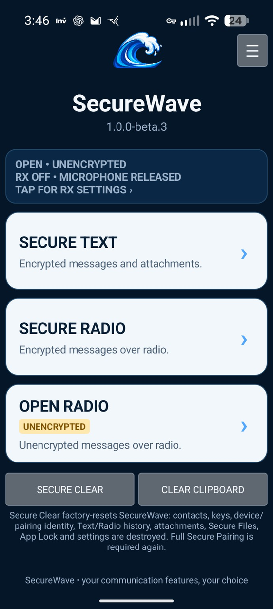
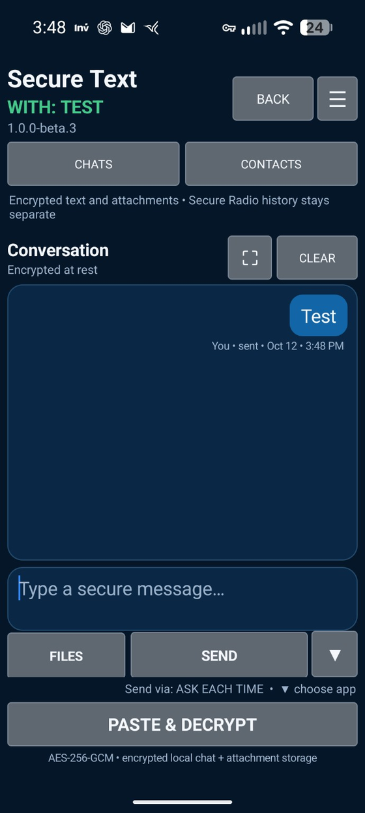
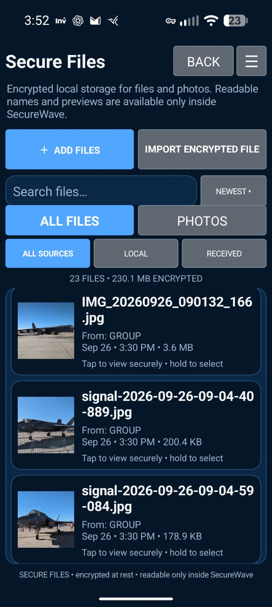
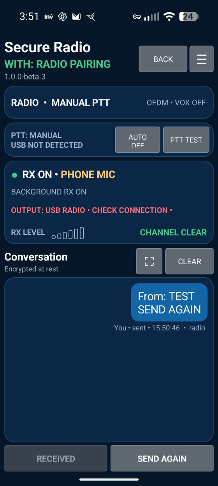
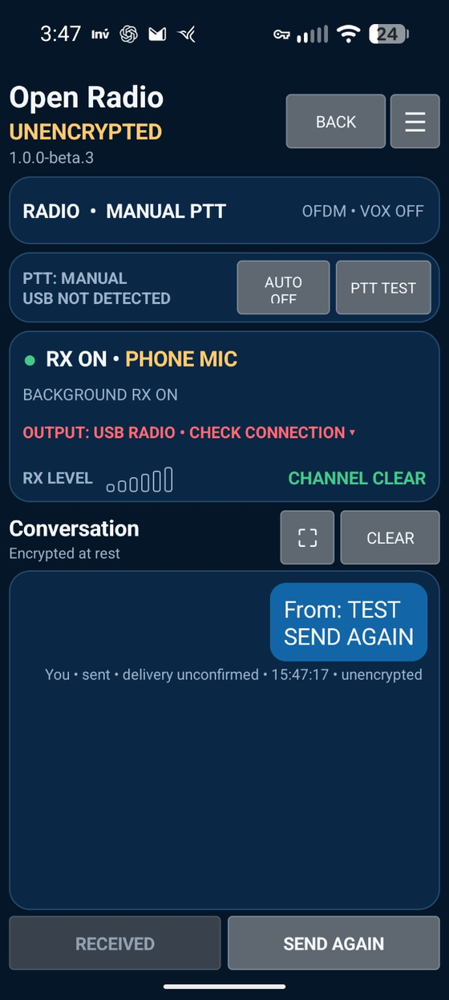
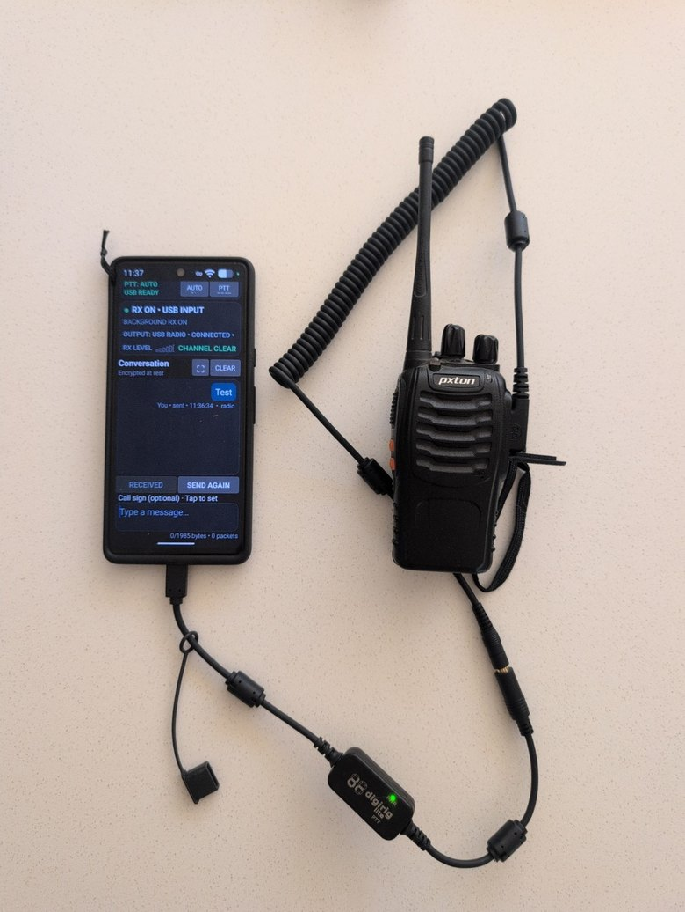

# SecureWave

**SecureWave is a proprietary Android application for secure, user-controlled communications and encrypted local files.**

SecureWave combines encrypted text preparation and exchange, an encrypted file vault, contact pairing, and radio/audio communication tools in one application. It is designed to operate without requesting Android's `INTERNET` permission; sharing encrypted messages through another app uses that app's separate network permissions and privacy practices.

> **Release status:** The next beta release, **1.0.0-beta.5-r15**, is under review and is **not currently published**. Do not treat an older beta or a screenshot as proof that a feature is included in a particular APK.

## Actual SecureWave screenshots

The screenshots below are from the SecureWave project images already uploaded to this GitHub repository. They are **real application screenshots**, not mockups or AI-generated illustrations. They may represent an earlier build and are shown for orientation; the exact interface can change between releases.

### Main screen and secure messaging

| SecureWave Home | Secure Text |
|:---:|:---:|
|  |  |

### Secure Files and encrypted radio

| Secure Files | Secure Radio |
|:---:|:---:|
|  |  |

### Open Radio and radio hardware setup

| Open Radio — unencrypted | Radio hardware setup |
|:---:|:---:|
|  |  |

> **Screenshot hosting:** These files currently reside on the `release-prep-beta5-r15` branch. If that branch is removed, these image links will break. For permanent hosting, copy the *original image files* to `screenshots/` on `main` and change the links to relative paths, e.g. `screenshots/securewave-home.png`. Do not upload proprietary source code.

## Capabilities

- **Secure Text:** Prepare authenticated encrypted text for user-selected external transport.
- **Secure pairing:** Contact and key-verification workflows for establishing trusted keys.
- **Secure Files:** Encrypted local storage and exchange of protected attachments or file bundles.
- **Secure Radio:** Encrypted radio/audio messaging using compatible equipment and authorized frequencies.
- **Open Radio:** Unencrypted radio communication; **not** a confidential channel.
- **Local-first design:** SecureWave does not request Android's `INTERNET` permission. External apps chosen to send encrypted content may use the network.

Features and interface details depend on the exact build and connected hardware.

## Downloads and installation

Official APK releases, when available, will be published here:

**[SecureWave GitHub Releases](https://github.com/TerminalAirspeed/SecureWaveApp/releases)**

1. Download an APK **only from the official releases page**.
2. Check its SHA-256 hash against the checksum published with that release.
3. On an Android device, allow installation from your chosen file manager or browser only when prompted and only if you trust the package.
4. Install the APK. When updating an existing installation, **do not uninstall the previous version** unless you have separately confirmed what that means for locally stored keys and files.

The intended upcoming beta targets **Android 10 (API 29) or newer**, subject to verification of the final release APK.

## Privacy and security boundaries

- SecureWave's application process is designed for offline/local operation. **No `INTERNET` permission** is requested by the audited beta build, but this does not mean external transport applications are offline.
- Encryption does not guarantee message delivery or hide all metadata such as participant identities, message timing or payload size from external services.
- Disappearing messages cannot guarantee removal from external applications, screenshots, backups or recipient-controlled devices.
- The application has **not received an independent security audit or certification**. Do not rely on a beta for emergencies, life safety or mission-critical secrecy.
- **Open Radio is unencrypted.** Use of encryption over radio is subject to service-specific rules. Encrypted transmissions generally are prohibited on U.S. amateur-radio and GMRS services.

## Licensing and source code

SecureWave is **free to use** when distributed through authorized official channels, but it is **proprietary software, not an open-source release**. The Android Studio source code is not published in this repository. Unofficial APK redistribution or modification is not authorized under the proposed proprietary freeware terms, except where applicable law or separate third-party licenses provide otherwise.

The final owner-approved license and all required third-party notices will accompany an approved public release. This README is not a substitute for those documents.

## Feedback and responsible disclosure

Use [GitHub Issues](https://github.com/TerminalAirspeed/SecureWaveApp/issues) for **non-sensitive** bug reports. Do not publish passwords, cryptographic keys, pairing codes, private messages, personal contacts or unredacted logs. Security vulnerabilities should be reported privately using GitHub's private vulnerability reporting if enabled.

---

**SecureWave** · Proprietary Android software · Public documentation and approved APK distribution only
